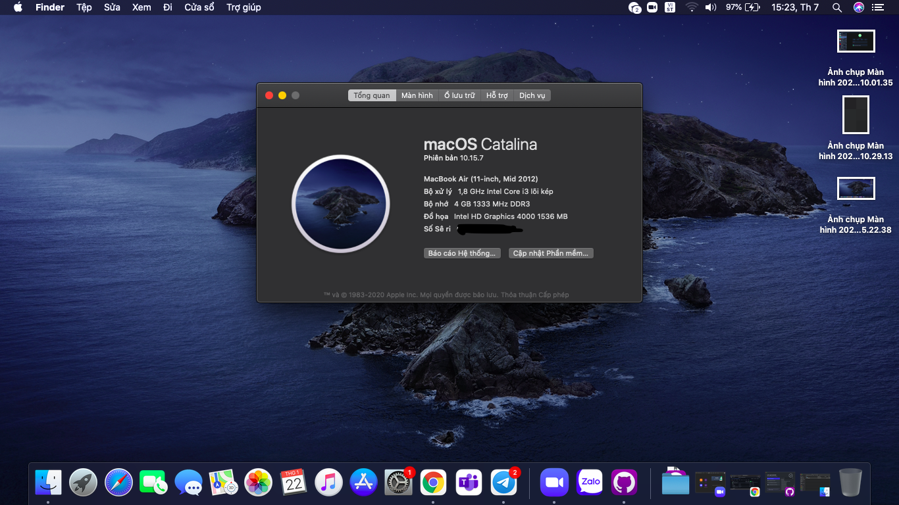

# Asus-X202E-Hackintosh


## What is working normally
```
Everything
```

## What is NOT working
```
Bluetooth - common bug of Atheros wifi card when Hackintosh (I will move to Big Sur as soon as I get my hands on Intel AC7260 wifi card)
```

## Project discontinued since I moved to MSI GF63 Thin 11SC (which I've hackintoshed but the 3d acceleration is broken so no EFI lmao)
## Also that asus fucked up laptop broke the charging port on its own so ehhh
